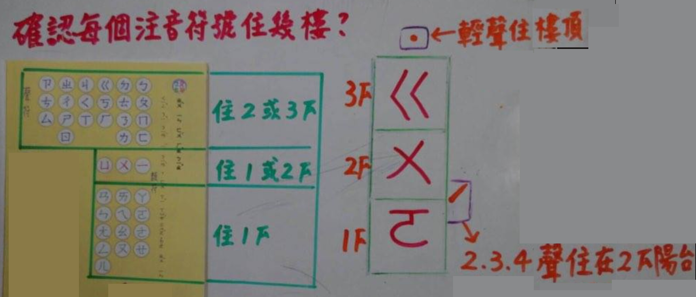

# Chinese Zhuyin (注音) 37 of them

:::{div}
:class: index-table-page

| 1 | 2 | 3 | 4 | 5 | 6 | 7 | 8 | 9 | 10 | 11 | 12 | 13 | 14 | 15 | 16 | 17 | 18 | 19 | 20 | 21 | 22 | 23 | 24 | 25 | 26 | 27 | 28 | 29 | 30 | 31 | 32 | 33 | 34 | 35 | 36 | 37 |
|---|---|---|---|---|---|---|---|---|---|---|---|---|---|---|---|---|---|---|---|---|---|---|---|---|---|---|---|---|---|---|---|---|---|---|---|---|
| [ㄅ](../chinese/u3105.md) | [ㄆ](../chinese/u3106.md) | [ㄇ](../chinese/u3107.md) | [ㄈ](../chinese/u3108.md) | [ㄉ](../chinese/u3109.md) | [ㄊ](../chinese/u310a.md) | [ㄋ](../chinese/u310b.md) | [ㄌ](../chinese/u310c.md) | [ㄍ](../chinese/u310d.md) | [ㄎ](../chinese/u310e.md) | [ㄏ](../chinese/u310f.md) | [ㄐ](../chinese/u3110.md) | [ㄑ](../chinese/u3111.md) | [ㄒ](../chinese/u3112.md) | [ㄓ](../chinese/u3113.md) | [ㄔ](../chinese/u3114.md) | [ㄕ](../chinese/u3115.md) | [ㄖ](../chinese/u3116.md) | [ㄗ](../chinese/u3117.md) | [ㄘ](../chinese/u3118.md) | [ㄙ](../chinese/u3119.md) | [ㄧ](../chinese/u3127.md) | [ㄨ](../chinese/u3128.md) | [ㄩ](../chinese/u3129.md) | [ㄚ](../chinese/u311a.md) | [ㄛ](../chinese/u311b.md) | [ㄜ](../chinese/u311c.md) | [ㄝ](../chinese/u311d.md) | [ㄞ](../chinese/u311e.md) | [ㄟ](../chinese/u311f.md) | [ㄠ](../chinese/u3120.md) | [ㄡ](../chinese/u3121.md) | [ㄢ](../chinese/u3122.md) | [ㄣ](../chinese/u3123.md) | [ㄤ](../chinese/u3124.md) | [ㄥ](../chinese/u3125.md) | [ㄦ](../chinese/u3126.md) |

<a href="../chinese/ZhuyinTable.html">ZhuyinTable — full tone table, 6,115 syllables</a>
---

3F (Consonants)(子音) 21 of them

| 1 | 2 | 3 | 4 | 5 | 6 | 7 | 8 | 9 | 10 | 11 | 12 | 13 | 14 | 15 | 16 | 17 | 18 | 19 | 20 | 21 |
|---|---|---|---|---|---|---|---|---|---|---|---|---|---|---|---|---|---|---|---|---|
| [ㄅ](../chinese/u3105.md) | [ㄆ](../chinese/u3106.md) | [ㄇ](../chinese/u3107.md) | [ㄈ](../chinese/u3108.md) | [ㄉ](../chinese/u3109.md) | [ㄊ](../chinese/u310a.md) | [ㄋ](../chinese/u310b.md) | [ㄌ](../chinese/u310c.md) | [ㄍ](../chinese/u310d.md) | [ㄎ](../chinese/u310e.md) | [ㄏ](../chinese/u310f.md) | [ㄐ](../chinese/u3110.md) | [ㄑ](../chinese/u3111.md) | [ㄒ](../chinese/u3112.md) | [ㄓ](../chinese/u3113.md) | [ㄔ](../chinese/u3114.md) | [ㄕ](../chinese/u3115.md) | [ㄖ](../chinese/u3116.md) | [ㄗ](../chinese/u3117.md) | [ㄘ](../chinese/u3118.md) | [ㄙ](../chinese/u3119.md) |

2F (Midtones/Middle Phonetics)(中間音) 3 of them

| 1 | 2 | 3 |  |  |  |  |  |  |  |  |  |  |  |  |  |  |  |  |  |  |
|---|---|---|---|---|---|---|---|---|---|---|---|---|---|---|---|---|---|---|---|---|
| [ㄧ](../chinese/u3127.md) | [ㄨ](../chinese/u3128.md) | [ㄩ](../chinese/u3129.md) |  |  |  |  |  |  |  |  |  |  |  |  |  |  |  |  |  |  |

1F (Vowels)(母音/元音) 13 of them

| 1 | 2 | 3 | 4 | 5 | 6 | 7 | 8 | 9 | 10 | 11 | 12 | 13 |  |  |  |  |  |  |  |  |
|---|---|---|---|---|---|---|---|---|---|---|---|---|---|---|---|---|---|---|---|---|
| [ㄚ](../chinese/u311a.md) | [ㄛ](../chinese/u311b.md) | [ㄜ](../chinese/u311c.md) | [ㄝ](../chinese/u311d.md) | [ㄞ](../chinese/u311e.md) | [ㄟ](../chinese/u311f.md) | [ㄠ](../chinese/u3120.md) | [ㄡ](../chinese/u3121.md) | [ㄢ](../chinese/u3122.md) | [ㄣ](../chinese/u3123.md) | [ㄤ](../chinese/u3124.md) | [ㄥ](../chinese/u3125.md) | [ㄦ](../chinese/u3126.md) | | | | | | | | |

:::
